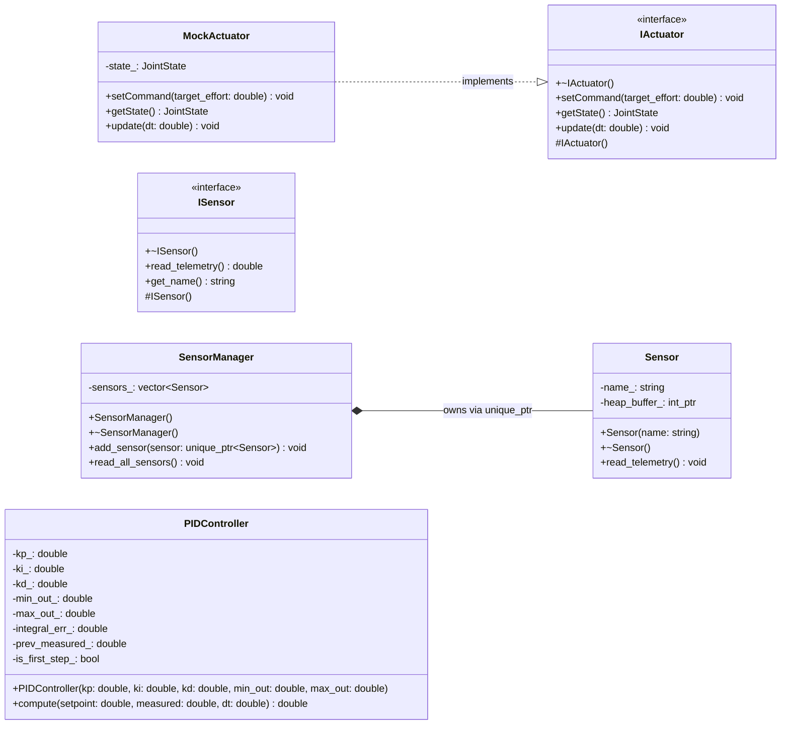
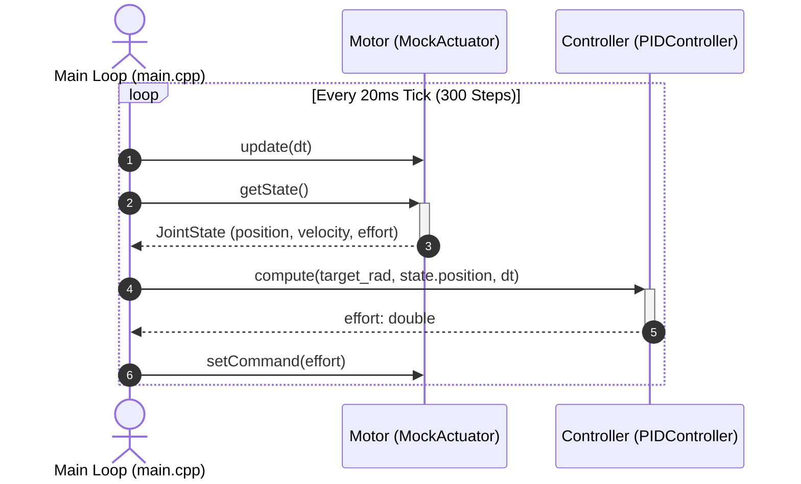

# CPS Engine

A C++20 Cyber-Physical Systems (CPS) and Physical AI control prototype featuring a deterministic 50 Hz closed-loop joint control, RAII hardware abstraction, and sensor lifecycle management.

The end-to-end processing pipeline follows: **Sense → Estimate → Plan → Actuate → Observe**.

---

## Key Features & Architecture
- **Closed-Loop Control & Physics (`src/control/`, `src/actuators/`):** Features a discrete-time `PIDController` utilizing derivative-on-measurement, first-step guards, and integral anti-windup/saturation. Paired with an `IActuator` interface and a `MockActuator` that simulates 1-DOF joint dynamics via semi-implicit Euler integration.
- **Real-Time Scheduling:** Executes a 50 Hz control loop (`dt = 0.02s`) via `std::chrono::steady_clock` and `std::this_thread::sleep_until`.
- **RAII Sensor Management (`src/sensor*.cpp`):** Implements strict resource ownership using `std::unique_ptr`, non-copyable semantics, and deterministic teardown.

## Class Diagram



## Sequence Diagram




---

## Build and Run

### Requirements
- CMake 3.10+
- C++20 compatible compiler (Clang / GCC / MSVC)
- macOS or Linux

### Build & Execution
From the project root:
```bash
cmake -S . -B build
cmake --build build
./build/cps_engine
```

---
