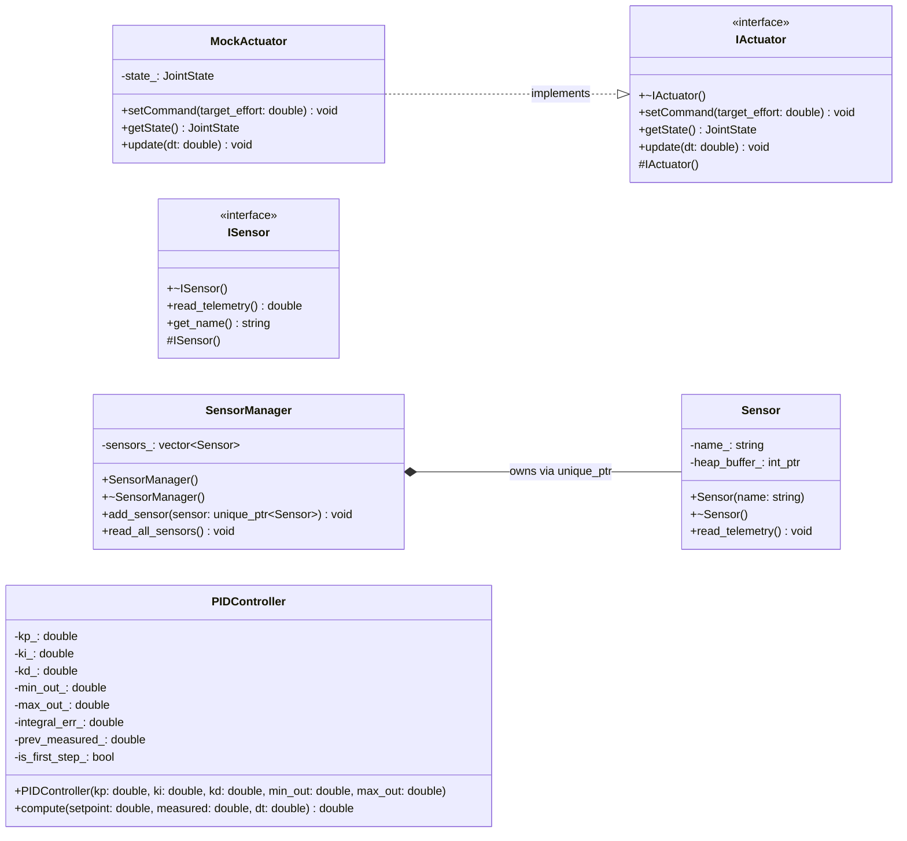
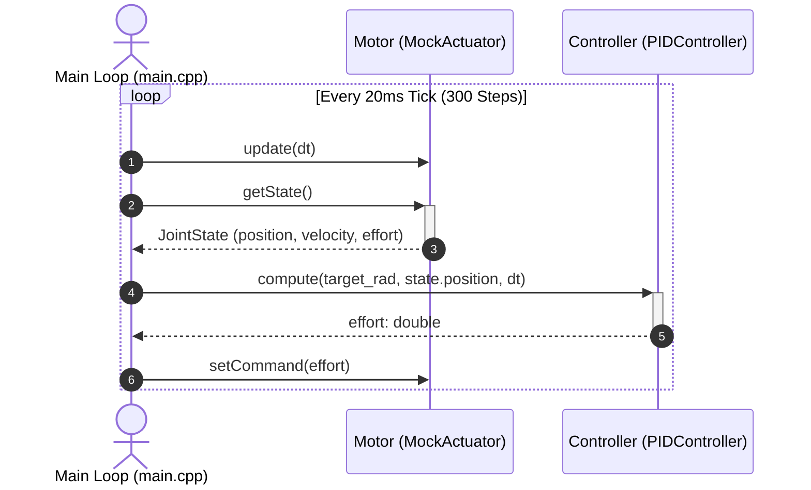

# CPS-Engine: C++20 Cyber-Physical Control & HAL Framework

A modular C++20 control and hardware abstraction engine designed for deterministic closed-loop actuation, sensor fleet lifecycle management, and spatial robotics simulation.

The end-to-end processing pipeline follows: **Simulate/Step → Observe State → Compute Effort → Actuate Command**.

---

## Implemented Architecture (Phase 1)

* **Closed-Loop PID Control (`PIDController`):** Bounded discrete-time feedback controller featuring actuator saturation clamping (`std::clamp`), integral anti-windup, zero/negative time-step fail-safes, and derivative-on-measurement to eliminate setpoint derivative kick.
* **Hardware Abstraction Layer (`IActuator` / `ISensor`):** Pure virtual, non-copyable hardware contracts decoupling high-level control loops from underlying driver physics and telemetry buses.
* **Deterministic 50 Hz Execution Loop:** Monotonic clock synchronization (`std::chrono::steady_clock`) driving second-order damped actuator dynamics to sub-microradian steady-state convergence.
* **RAII Resource Management (`SensorManager`):** Exclusive hardware handle ownership via `std::unique_ptr` and move semantics (`std::move`), guaranteeing deterministic teardown without manual memory management.
* **Zero-Sleep Verification Suite (CTest):** Deterministic unit tests verifying saturation bounds, bad time-step rejection, derivative-kick suppression, and closed-loop convergence in under 10 ms.


## Project Structure

```text
cps-engine/
├── CMakeLists.txt
├── include/
│   ├── actuators/
│   │   ├── iactuator.hpp
│   │   └── mock_actuator.hpp
│   ├── control/
│   │   └── pid.hpp
│   ├── core/
│   │   └── types.hpp
│   └── sensors/
├── src/
│   ├── actuators/mock_actuator.cpp
│   ├── control/pid.cpp
│   ├── sensor.cpp
│   ├── sensor_manager.cpp
│   └── main.cpp
└── tests/
    └── test_pid.cpp
```

## Class Diagram



## Sequence Diagram




---


## Active Development Roadmap
- Phase 2 (In Progress): 3D Forward & Inverse Kinematics solver utilizing Eigen3 homogeneous transformations and workspace boundary validation.
- Phase 3 (Planned): Containerized ROS 2 joint-state publisher and RViz 6-DOF manipulator visualization.

## Build and Run

### Requirements
- CMake 3.10+
- C++20 compatible compiler (Clang / GCC / MSVC)
- macOS or Linux

### Build & Verification
From the project root:
```bash
cmake -S . -B build -DCMAKE_BUILD_TYPE=Release
cmake --build build
ctest --test-dir build --output-on-failure
./build/cps_engine
```
<details>
<summary>View Sample Run Output</summary>

```text
=== CPS Engine: Boot Sequence ===
[Hardware Connected] LiDAR_Front initialized. Heap buffer allocated at: 0x104eea030
[LIFECYCLE] Transferring ownership to SensorManager...
[Step 0] Pos: 0 rad | Err: 1.57 rad | Effort: 10
...
[Step 299] Pos: 1.57 rad | Err: 2.63767e-07 rad | Effort: 1.93673e-05
[SHUTDOWN] System halt. Initiating RAII teardown...
```
</details>


---
